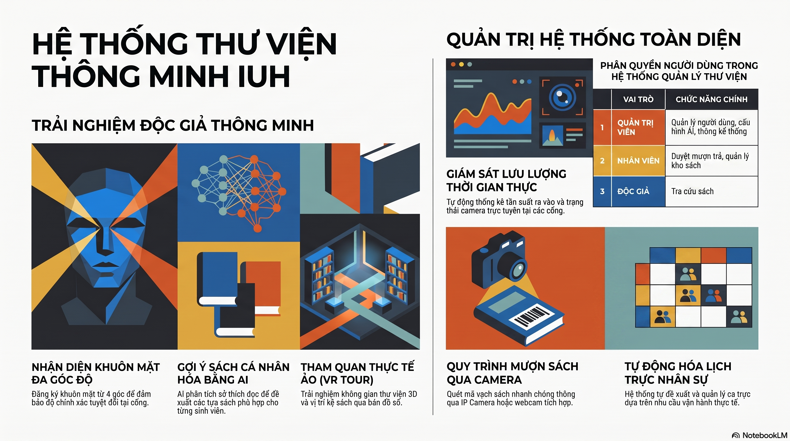

# Thư Viện Thông Minh — Frontend Web


# Face Recognition Platform - Frontend

Giao diện web quản lý thư viện thông minh — dashboard cho admin/nhân viên, mượn/trả sách, AI chatbot, quản lý bạn đọc, nhận diện khuôn mặt, VR tour và kiosk cổng ra vào.



## Architecture

```
Frontend_Web/
├── src/
│   ├── app/
│   │   ├── _components/         # Shared UI components
│   │   │   ├── landing/         # 3D landing (Three.js, @react-three/fiber)
│   │   │   ├── UndoSnackbar.tsx
│   │   │   ├── ReauthOverlay.tsx
│   │   │   ├── ClientLayout.tsx
│   │   │   ├── CameraFallback.tsx
│   │   │   └── HoldButton.tsx
│   │   ├── (dashboard)/         # Protected dashboard routes
│   │   │   ├── _components/     # Dashboard-specific components (sidebar, AI widget, stat cards, tables)
│   │   │   ├── dashboard/       # Overview, admin panel
│   │   │   ├── borrow/          # Mượn sách
│   │   │   ├── return/          # Trả sách
│   │   │   ├── books/           # Danh mục sách, chi tiết sách
│   │   │   ├── history/         # Lịch sử mượn trả
│   │   │   ├── patrons/         # Quản lý bạn đọc
│   │   │   ├── active/          # Bạn đọc đang ở thư viện
│   │   │   ├── enroll/          # Đăng ký khuôn mặt
│   │   │   ├── verify/          # Xác thực khuôn mặt
│   │   │   ├── identify/        # Nhận diện khuôn mặt
│   │   │   ├── liveness/        # Kiểm tra sống (liveness)
│   │   │   ├── ai-assistant/    # AI chatbot hỗ trợ thư viện
│   │   │   ├── notifications/   # Thông báo
│   │   │   ├── profile/         # Hồ sơ cá nhân
│   │   │   ├── staff-schedules/ # Lịch làm việc
│   │   │   ├── stats/           # Thống kê thư viện
│   │   │   ├── error.tsx
│   │   │   └── layout.tsx
│   │   ├── (kiosk)/             # Kiosk mode — màn hình cổng ra vào
│   │   │   └── gate/
│   │   ├── library/
│   │   │   └── vr-tour/         # Tham quan thư viện 3D/VR
│   │   ├── api/                 # Next.js API routes (proxy)
│   │   ├── login/
│   │   ├── register/
│   │   ├── page.tsx             # Landing page với 3D scene
│   │   ├── layout.tsx
│   │   └── globals.css
│   ├── lib/
│   │   ├── api-client.ts        # Axios client với JWT interceptor
│   │   ├── auth-context.tsx      # Auth context + refresh token
│   │   ├── mui-theme.tsx         # MUI theme (dark/light/auto)
│   │   ├── types.ts             # TypeScript interfaces
│   │   ├── animations.ts        # Framer motion variants
│   │   ├── hooks/               # Custom React hooks
│   │   ├── mock-data/           # Dữ liệu mẫu cho UI
│   │   └── vr/                  # VR tour helpers
│   ├── hooks/                   # Global hooks
│   └── middleware.ts             # Next.js middleware — auth guard
├── public/
├── e2e/                         # Playwright E2E tests
├── next.config.js               # Rewrites /api/* → backend gateway
├── tailwind.config.ts
├── jest.config.mjs
└── playwright.config.ts
```

## Pages

| Route | Auth | Mô tả |
|-------|------|-------|
| `/` | No | Landing page với 3D library scene |
| `/login` | No | Đăng nhập (mật khẩu / khuôn mặt) |
| `/register` | No | Đăng ký tài khoản bạn đọc |
| `/dashboard` | Yes | Dashboard tổng quan thư viện |
| `/dashboard/admin` | Admin | Quản lý người dùng (admin panel) |
| `/borrow` | Yes | Mượn sách |
| `/return` | Yes | Trả sách |
| `/books` | Yes | Danh mục sách |
| `/books/[id]` | Yes | Chi tiết sách |
| `/history` | Yes | Lịch sử mượn/trả |
| `/patrons` | Yes | Quản lý bạn đọc |
| `/patrons/[id]` | Yes | Chi tiết bạn đọc |
| `/active` | Yes | Bạn đọc đang ở thư viện (real-time) |
| `/enroll` | Yes | Đăng ký khuôn mặt (webcam) |
| `/verify` | Yes | Xác thực khuôn mặt |
| `/identify` | Yes | Nhận diện khuôn mặt |
| `/liveness` | Yes | Kiểm tra sống (liveness detection) |
| `/ai-assistant` | Yes | AI chatbot hỗ trợ thư viện |
| `/notifications` | Yes | Thông báo |
| `/profile` | Yes | Hồ sơ cá nhân |
| `/staff-schedules` | Yes | Lịch làm việc nhân viên |
| `/stats` | Yes | Thống kê hoạt động thư viện |
| `/gate` | No | Kiosk cổng ra vào (check-in/out) |
| `/library/vr-tour` | No | Tham quan thư viện 3D |

## Tech Stack

- **Next.js 15** (App Router, Turbopack)
- **React 19** với Server Components
- **TypeScript** 5
- **MUI** 9 (Material UI) — dashboard components
- **Tailwind CSS** — utility styling
- **Framer Motion** — animation, layout transitions
- **Three.js** (`@react-three/fiber`, `@react-three/drei`) — 3D landing, VR tour
- **Axios** + JWT interceptor — API client
- **react-webcam** — chụp ảnh từ camera
- **@zxing** — QR/barcode scanner
- **Jest** + **Playwright** — unit test + E2E

## API Integration

Frontend giao tiếp với backend qua API Gateway (`http://localhost/api`). Cấu hình trong `next.config.js`:

```js
// Rewrites /api/* → http://127.0.0.1:80/api/*
async rewrites() { ... }
```

### Auth Flow

1. Đăng nhập → nhận `access_token` + `refresh_token`
2. Lưu token trong localStorage
3. Axios interceptor tự động gắn `Authorization: Bearer <token>`
4. 401 → auto refresh token → retry request
5. Hết hạn refresh → redirect `/login`

## Cài đặt

### Yêu cầu

- Node.js 20 LTS
- Backend đang chạy (xem `Backend/README.md`)

### Local dev

```bash
# 1. Cài dependencies
npm install

# 2. Tạo .env.local
echo NEXT_PUBLIC_API_URL=http://localhost/api > .env.local

# 3. Start backend (riêng terminal)
cd ../Backend
docker compose up -d

# 4. Start frontend
cd ../Frontend_Web
npm run dev
```

Truy cập http://localhost:3000

### Docker

```bash
cd ../Backend
docker compose up -d

cd ../Frontend_Web
docker compose up -d
```

## Scripts

```bash
npm run dev      # Dev server (Turbo)
npm run build    # Build production
npm run start    # Start production
npm run lint     # ESLint
npm test         # Jest unit tests
npx playwright test  # E2E tests
```

## Tính năng chính

### Dashboard
- Thống kê real-time: bạn đọc trong thư viện, lượt ra vào, sách đang mượn
- Biểu đồ hoạt động theo giờ/ngày/tuần
- AI widget gợi ý sách, trả lời câu hỏi

### Face Recognition
- Đăng ký khuôn mặt qua webcam
- Xác thực khuôn mặt (1:1)
- Nhận diện khuôn mặt (1:N)
- Kiểm tra sống (liveness detection)

### Mượn/Trả sách
- Quét QR/barcode sách
- Tìm kiếm danh mục
- Lịch sử mượn trả
- Gợi ý sách từ AI

### Cổng ra vào (Kiosk)
- Check-in/out bằng khuôn mặt
- Màn hình cảm ứng cho cổng thư viện

### Quản lý
- Bạn đọc (patron CRUD, gia hạn thẻ, khóa)
- Nhân viên (lịch làm việc, ca, chấm công)
- Thống kê báo cáo

## Environment

| Variable | Default | Mô tả |
|----------|---------|-------|
| `NEXT_PUBLIC_API_URL` | `/api` | Backend API Gateway URL |

## Troubleshooting

Xem `docker compose logs` của backend nếu API không hoạt động. Đảm bảo `.env.local` tồn tại và backend service đang `Healthy`.
1. [ ] Docker Desktop is running
2. [ ] Backend is fully built and running (`docker-compose ps` shows all Up/Healthy)
3. [ ] TypeScript services built (`npm run build` succeeds locally)
4. [ ] `.env.local` exists with correct `NEXT_PUBLIC_API_URL`
5. [ ] `npm install` completed without errors
6. [ ] Port 3000 (frontend) and 80 (backend gateway) are free
7. [ ] Browser has camera permissions for face recognition features
